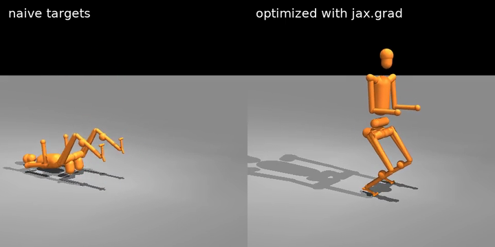

# The H1 model (`fixtures/h1`)

`h1_train.mjb` is the Unitree H1 humanoid for the engine: a floating base and 19 hinge joints, each driven by a
position (PD) actuator, on a flat floor. It is built from the Unitree H1 description in
[MuJoCo Menagerie](https://github.com/google-deepmind/mujoco_menagerie) by `scripts/make_h1_model.py`, which applies
the recipe that turned Menagerie's G1 into the mjlab G1 (`fixtures/mjlab/README.md`).

`nablaengine.fixtures.load_model(fixtures.H1)` loads the model and checks that the engine supports it; the JAX and
PyTorch interfaces take it as `init(model=m, foot_pairs=meta["foot_pairs"])`. `scripts/h1_check.py` (in
`scripts/verify.sh`) checks the engine on it against MuJoCo C in float64.

| File | Content |
|---|---|
| `h1_train.mjb` | The compiled model in MuJoCo's binary format, 142655 bytes, sha256 `397dabd9e31f284133533d548b45eee96b4f4697b27febc1a80eee7ccd553ae9`. |
| `h1_meta.json` | Metadata of the model, with the same keys as `fixtures/mjlab/g1_meta.json` (`robot`: `"h1"`). |
| `LICENSE` | The licence of the Unitree H1 description (BSD 3-Clause), copied verbatim from MuJoCo Menagerie. |

## The model

| | |
|---|---|
| Degrees of freedom | `nq` 26, `nv` 25: a free root joint and 19 hinge joints. 21 bodies (the world included), 19 actuators. |
| Collision geometry | 33 geoms: the floor plane, 6 spheres and 26 capsules, 3 of them on each sole. No meshes, boxes or other geom types. |
| Contacts | 457 explicit contact pairs and nothing else; the 6 sole-floor pairs are `foot_pairs` (per-world friction). |
| Options | Timestep 5 ms, Newton solver, pyramidal friction cones, `implicitfast` integrator, Euler damping disabled. |
| Actuators | kp 394.8, kd 25.1 on every joint (mjlab's 10 Hz, damping ratio 2, from Menagerie's armature 0.1); Menagerie's torque limits as the joints' actuator force ranges. |
| Control step | 4 substeps (20 ms). |
| Other content | The keyframe `home`, a light, the IMU site; `torso_link` takes the per-world COM offset. |

With `nv` 25 the H1 runs the engine's solves with the lanes past `NV` masked (capability warning H3) and the register
Cholesky instead of the G1's tuned broadcast variant (H5).

Joint PD alone does not keep the H1 standing: its centre of mass is about 2 cm in front of the heels at the home
keyframe, and it tips backwards within about two seconds, as Menagerie's model does under the same gains. `examples/squat_trajopt.py --robot h1` optimizes open-loop setpoints through the engine's gradients that keep it up
through a 15 cm squat and back (400 Adam iterations, 26 s on an RTX 4060 Laptop GPU): pelvis height within 1.3 cm of
the reference, tilt below 0.08 rad, 1.4 cm drift; replayed open loop in float64 MuJoCo it squats and stands the same
way (qpos within 2e-2: on the edge of balance the float32 / float64 roundings grow).

<p align="center"></p>

<sub>`examples/squat_trajopt.py --robot h1` at 1.5 s, the bottom of the squat: the naive setpoints (left) have tipped
the H1 over, the optimized ones (right) hold it at 0.82 m pelvis height (reference 0.83 m).</sub>

## Speed

Time per 20 ms control step at the interface defaults (10 Newton iterations), JAX, on one RTX 4060 Laptop GPU (sm_89,
nvcc 12.4), medians of 5 rounds of 50 calls; the H1 on 1024 states of `scripts/h1_check.py`'s rollouts (standing to
lying), the G1 on `mf_s0`, tiled to B worlds:

| B | H1 forward | H1 forward + VJP | G1 forward | G1 forward + VJP |
|---|---|---|---|---|
| 1024 | 1.47 ms | 1.98 ms | 1.86 ms | 2.71 ms |
| 4096 | 4.81 ms (1.17 us / world) | 6.77 ms (1.65 us / world) | 7.02 ms (1.71 us / world) | 10.52 ms (2.57 us / world) |

The H1 takes the register Cholesky, not the G1's tuned broadcast one, and is still faster per world (fewer dofs and
bodies). For scale, MJX (`mujoco-mjx` 3.17.0, default options, 10 iterations, `jax.vmap` of four `mjx.step`) takes
1347 ms (H1) and 1560 ms (G1) for the forward of 4096 worlds on the same GPU; these timings are not the paper
benchmark's (`benchmarks/README.md`).

## How it was derived

The source is MuJoCo Menagerie at commit
[`98a70c569c4c1b6da467a20012f766ee1f8dc521`](https://github.com/google-deepmind/mujoco_menagerie/tree/98a70c569c4c1b6da467a20012f766ee1f8dc521/unitree_h1),
file `unitree_h1/scene.xml` (which includes `unitree_h1/h1.xml`). The steps are those of `scripts/make_h1_model.py`
(its docstring lists them): cylinders and the torso box replaced by capsules, explicit contact pairs as in mjlab's G1
contact set (minus three pairs whose capsules touch at the home keyframe), meshes, materials and textures removed,
5 ms and `implicitfast`, position servos with mjlab's gains and setpoint range, no joint damping, MuJoCo's default
joint-limit parameters. With `mujoco==3.17.0` the script reproduces `h1_train.mjb` byte for byte:

```bash
git clone https://github.com/google-deepmind/mujoco_menagerie && git -C mujoco_menagerie checkout 98a70c5
python scripts/make_h1_model.py --menagerie mujoco_menagerie --out fixtures/h1
```

## Licences

- **Unitree H1 description** (MuJoCo Menagerie `unitree_h1`): Copyright (c) 2016-2023 HangZhou YuShu TECHNOLOGY
  CO.,LTD. ("Unitree Robotics"), BSD 3-Clause License. Its full text is `LICENSE` in this directory, and it applies to
  `h1_train.mjb`, a modified binary form of that description.
- **mjlab**: Apache License 2.0, Copyright 2025, The mjlab Developers. The conversion follows mjlab's G1
  configuration (the contact set, the contact and joint parameters, the PD gain design and the setpoint range); it
  contains no mjlab code.
- The other files of this directory are covered by the repository's licence (Apache-2.0).

Unitree Robotics, Google DeepMind and the mjlab developers do not endorse this project. Their names are used only to
identify the sources.
